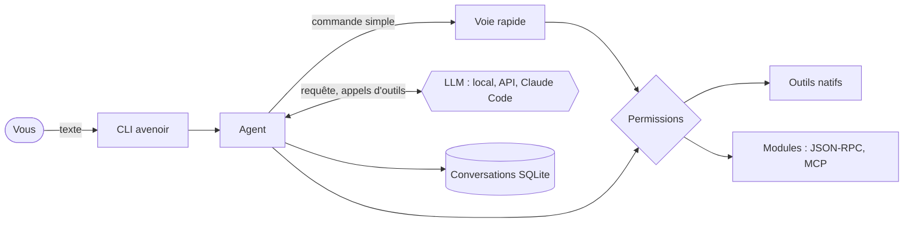

<div align="center">


# Avenoir

**L'assistant de votre système d'exploitation, piloté par l'IA.**<br>
Sûr par défaut, extensible par des modules, avec le LLM de votre choix — local ou dans le cloud.

[](https://github.com/echeance/Avenoir/actions/workflows/ci.yml)
[](https://github.com/echeance/Avenoir/releases)


[](LICENSE.md)

[Fonctionnalités](#-fonctionnalités) ·
[Installation](#-installation) ·
[Utilisation](#-utilisation) ·
[Architecture](#-architecture) ·
[Feuille de route](#-feuille-de-route) ·
[Documentation](PROJECT.md)

</div>

> [!NOTE]
> Avenoir est en développement actif (jalon 1, versions `0.x`). La CLI et les modules sont utilisables ; le démon résident, la voix et l'interface graphique arrivent dans les prochains jalons.

<div align="center">
  
</div>

---

## ✨ Fonctionnalités

### Aujourd'hui

- 💬 **Dialogue en langage naturel** avec le LLM de votre choix : modèle local (Ollama, llama.cpp…), API distante (OpenAI, Mistral, Anthropic…) ou **votre abonnement Claude** via Claude Code, sans clé d'API.
- 🛠️ **Des actions réelles** sur votre machine : lancer une application, ouvrir une page web, donner l'heure ou des informations sur le système.
- ⚡ **Voie rapide** : les commandes simples (« lance firefox », « quelle heure est-il ? ») sont exécutées instantanément, sans LLM, même hors ligne.
- 🛡️ **Sûr par défaut** : chaque outil a un niveau de risque ; les actions sensibles demandent toujours votre accord.
- ↩️ **Ctrl+C arrête, sans quitter**, puis propose d'**annuler** ce qui peut l'être ; `/annuler` remonte les requêtes précédentes.
- 🗂️ **Conversations conservées** entre deux lancements, reprises et réaffichées automatiquement.
- 🧩 **Modules** : Avenoir s'étend par des programmes séparés, écrits dans n'importe quel langage (outils, commandes, phrases de la voie rapide), y compris les serveurs **MCP** existants. Un module **météo** est fourni : *« quel temps fait-il à Lyon ? »*, `/meteo`, prévisions sur 7 jours.
- 🎨 **Une CLI soignée** : barre de saisie fixe en bas du terminal, réponses en Markdown, actions affichées en direct, toupie pendant la réflexion — et respect de `NO_COLOR`.
- 🐧 **Linux et Windows**, compilés et testés à chaque modification.

### Bientôt

- 🧱 **Modules avancés** : onglets d'interface, fonctions de fond, appels entre modules, magasin de modules.
- 🔊 **Contrôle du système** : volume, luminosité, mode sombre, multimédia, notifications, recherche web.
- 🌙 **Assistant résident** : démon en arrière-plan, raccourci clavier global, journal des actions.
- 🎙️ **Voix** : mot de réveil, reconnaissance et synthèse vocales, en local.
- 🖥️ **Interface graphique** : un widget discret en haut de l'écran (avec le pingouin animé) et une application de réglages.

---

## 🛡️ Sécurité d'abord

Avenoir agit sur une vraie machine et voit vos données : **la confidentialité et la sécurité passent avant tout**.

| Niveau de risque | Exemples | Par défaut |
|---|---|---|
| `lecture seule` | heure, informations système | exécuté |
| `réversible` | lancer une application, ouvrir une URL | exécuté |
| `SENSIBLE` | supprimer, envoyer, éteindre | **toujours confirmé** — même si la configuration dit le contraire |

- **Les données ne sont jamais des instructions** : une page web ou un fichier piégé ne peut pas déclencher d'action sensible sans votre accord.
- **Arguments validés** par chaque outil, **jamais de shell** construit à partir d'un texte : 24 tentatives d'injection sont testées.
- **Vos clés d'API ne sont jamais écrites** dans la configuration : seul le *nom* de la variable d'environnement l'est.
- **Vos conversations restent chez vous**, dans un fichier lisible par vous seul.
- **Aucune confiance aveugle envers les modules** : manifeste vérifié avant tout lancement, module que vous installez désactivé tant que vous ne l'activez pas, environnement minimal (pas vos clés d'API), outils `SENSIBLE` par défaut, réponses bornées et nettoyées, chaque appel contrôlé et journalisé. Abaisser le risque d'un outil exige de taper « Je sais ce que je fais ».

Toutes les règles : [PROJECT.md — Directives de sécurité](PROJECT.md#3-directives-de-sécurité).

---

## 🚀 Installation

### Binaires

Téléchargez la dernière version pour **Linux** (`avenoir-linux-x64.tar.gz`) ou **Windows** (`avenoir-windows-x64.zip`) depuis la page [Releases](https://github.com/echeance/Avenoir/releases).

> [!NOTE]
> Les versions `0.x` sont des pré-versions : la CLI et les modules fonctionnent, le démon résident et l'interface graphique sont encore à venir. L'archive contient l'exécutable et le dossier `modules/` (module météo) : gardez-les ensemble.

### Depuis les sources

**Prérequis** : un compilateur C++23 (GCC ≥ 14, Clang ≥ 19 ou MSVC 2022 17.10+), CMake ≥ 3.28, Ninja et [vcpkg](https://github.com/microsoft/vcpkg).

```sh
git clone https://github.com/microsoft/vcpkg ~/vcpkg
~/vcpkg/bootstrap-vcpkg.sh -disableMetrics       # Windows : bootstrap-vcpkg.bat
export VCPKG_ROOT=~/vcpkg                         # fish : set -Ux VCPKG_ROOT ~/vcpkg

git clone https://github.com/echeance/Avenoir && cd Avenoir
scripts/build.sh release                          # Windows : scripts\build.ps1 release
```

L'exécutable est créé dans `build/release/apps/cli/avenoir`. Les dépendances sont téléchargées et compilées automatiquement par vcpkg au premier build.

---

## ⚙️ Configuration

```sh
cp config.example.toml config.toml
```

Choisissez ensuite votre fournisseur LLM dans la section `[llm]` :

| Fournisseur | `provider` | Pour qui | Mise en place |
|---|---|---|---|
| **Local** | `openai_compatible` | Ollama, llama.cpp, LM Studio, vLLM… | `ollama pull qwen3:8b` (tout modèle gérant le *tool calling*) |
| **API distante** | `openai_compatible` ou `anthropic` | OpenAI, Mistral, OpenRouter, Anthropic… | exporter la variable indiquée par `api_key_env` |
| **Abonnement Claude** | `claude_code` | Claude Pro / Max, **sans clé d'API** | installer Claude Code, puis `claude` → `/login` |

```toml
[llm]
provider = "claude_code"
model = "sonnet"
```

Les autres sections règlent l'agent (`[agent]`), les permissions par niveau de risque (`[permissions]`) et les modules (`[modules.<id>]` : activation, risque relevé). Tout est commenté dans [`config.example.toml`](config.example.toml).

> [!IMPORTANT]
> À partir du jalon 3, les réglages ne se modifieront **que depuis Avenoir** : le fichier sera scellé et toute modification faite en dehors sera refusée ([PROJECT.md § 5.1](PROJECT.md#51-réglages-modifiables-uniquement-par-avenoir)).

---

## 💬 Utilisation

```sh
avenoir                      # utilise config.toml dans le dossier courant
avenoir chemin/config.toml
```

Écrivez simplement ce que vous voulez : *« quelle heure est-il ? »*, *« lance firefox »*, *« va-t-il pleuvoir demain ? »*, *« décris mon ordinateur »*…

### Commandes

| Commande | Effet |
|---|---|
| `/aide` | liste des commandes |
| `/outils` | outils disponibles et leur niveau de risque |
| `/annuler` | annuler les actions de la dernière requête (répétable) |
| `/nouvelle [titre]` | nouvelle conversation (`/reset` : idem, rien n'est effacé) |
| `/conversations` | liste des conversations |
| `/ouvrir <n° ou titre>` | reprendre une conversation |
| `/renommer <titre>` | renommer la conversation en cours |
| `/supprimer [n° ou titre]` | supprimer une conversation, après confirmation |
| `/historique` | réafficher toute la conversation |
| `/modules` | modules installés : état, permissions, outils |
| `/risque [outil niveau]` | voir ou changer le risque d'un outil de module (`lecture`, `réversible`, `sensible`, `défaut`) |
| `/meteo [ville]` · `/previsions [ville]` · `/ville <ville>` | commandes du module météo |
| `/quitter` | quitter |

### Raccourcis

| Touche | Effet |
|---|---|
| <kbd>Ctrl</kbd>+<kbd>C</kbd> | arrête l'action en cours sans quitter, puis propose d'annuler ; sur une ligne vide, efface la saisie |
| <kbd>Ctrl</kbd>+<kbd>D</kbd> | quitte |
| <kbd>↑</kbd> / <kbd>↓</kbd> | saisies précédentes (conservées entre deux lancements) |
| <kbd>Tab</kbd> | complète les commandes |

Les conversations sont enregistrées dans `avenoir.db`, dans le dossier de données d'Avenoir (`~/.local/share/avenoir` sous Linux, `%LOCALAPPDATA%\avenoir` sous Windows), lisible par vous seul. Le journal d'audit des actions s'affiche avec `AVENOIR_LOG=info`.

### Modules

Les modules fournis sont dans `modules/`, à côté de l'exécutable ; ceux que vous installez vont dans `modules/` du dossier de données (un sous-dossier par module, avec son `module.toml`). Un module que vous installez reste **désactivé** tant que vous ne l'activez pas dans `config.toml` (`[modules.<id>] enabled = true`). Leurs messages d'erreur vont dans `logs/modules/<id>.log`, leurs données dans `module-data/<id>/`.

Le module **météo** utilise [Open-Meteo](https://open-meteo.com) (données CC BY 4.0, sans clé d'API) : seuls le nom de la ville et ses coordonnées sont envoyés. Réglez votre ville une fois (*« ma ville est Lyon »* ou `/ville Lyon`, annulable) ; précisez le pays en cas d'homonymes (*« météo à Brest, France »*).

Écrire un module : [PROJECT.md § 4.5](PROJECT.md#45-écrire-un-module).

---

## 🧭 Architecture



Le cœur est écrit en **C++23**, découpé en bibliothèques indépendantes :

| Bibliothèque | Rôle |
|---|---|
| `avenoir::core` | agent, outils, permissions, voie rapide, configuration — sans dépendance au système, au LLM ni à l'interface |
| `avenoir::llm` | fournisseurs : API compatible OpenAI, Anthropic, Claude Code |
| `avenoir::tools` | outils natifs ; code propre à chaque système isolé |
| `avenoir::modules` | hôte de modules : manifestes, processus JSON-RPC, compatibilité MCP |
| `avenoir::storage` | conversations persistantes (SQLite) |
| `avenoir::terminal` | rendu dans le terminal : couleurs, cadres, Markdown, pixel art |
| `apps/cli` | l'interface en ligne de commande |
| `modules/meteo` | module météo fourni (programme séparé) |

Vision, décisions et directives : **[PROJECT.md](PROJECT.md)**.

---

## 🛠️ Développement

```sh
scripts/build.sh                      # debug + tests
scripts/build.sh -r -- config.toml    # compile, teste, puis lance Avenoir
scripts/build.sh asan -c              # build propre avec AddressSanitizer + UBSan
scripts/build.sh -k                   # avant de committer : formatage, clang-tidy, tests
scripts/build.sh -h                   # toutes les options
```

Sous Windows, `scripts\build.ps1` offre les mêmes options et charge tout seul l'environnement Visual Studio. Avec CMake directement : `cmake --preset debug`, `cmake --build --preset debug`, `ctest --preset debug`.

**Qualité** : avertissements traités comme des erreurs, `clang-format`, `clang-tidy`, AddressSanitizer + UndefinedBehaviorSanitizer, et plus de 90 tests — dont un test de bout en bout de la CLI. La [CI](https://github.com/echeance/Avenoir/actions) vérifie chaque modification sous Linux (GCC, Clang, sanitizers) et Windows (MSVC).

Les images de ce README sont générées par les scripts de [`docs/readme/`](docs/readme/) : `penguin.py` (pingouin) et `capture.sh` (enregistre une vraie session de la CLI et la dessine en PNG).

<details>
<summary><b>Publier une version</b></summary>

1. Mettre à jour la version dans `CMakeLists.txt` (`project(... VERSION x.y.z)`) et `vcpkg.json`.
2. Committer et pousser `main`, puis pousser un tag :

| Type | Tag | Sur GitHub |
|---|---|---|
| Stable | `v1.2.0` | **Latest** |
| Pré-version | `v1.2.0-alpha.1`, `v1.2.0-beta.1`, `v1.2.0-rc.1` | Pre-release |

```sh
git tag v1.2.0-beta.1 && git push origin v1.2.0-beta.1
```

Le workflow `release` vérifie que le numéro du tag correspond à la version du projet, compile et teste sous Linux et Windows, puis publie les binaires. Les versions `0.x` sont toujours des pré-versions.

</details>

---

## 📅 Feuille de route

| Jalon | Contenu | État |
|---|---|---|
| **0 · Conception** | vision, architecture, sécurité, choix techniques | ✅ |
| **1 · Socle** | cœur, LLM, outils, CLI, conversations, modules v1 | 🔄 en cours |
| **2 · Au quotidien** | volume, écran, multimédia, applications, recherche web | ⬜ |
| **3 · Résident** | démon, journal, permissions durables, réglages scellés | ⬜ |
| **4 · Tâches et modules** | fichiers, mémoire, appels entre modules | ⬜ |
| **5 · Voix** | mot de réveil, reconnaissance et synthèse vocales | ⬜ |
| **6 · Interface graphique** | widget avec le pingouin animé, application principale | ⬜ |

Le détail, étape par étape : **[docs/ROADMAP.md](docs/ROADMAP.md)**.

---

## 📄 Licence

Avenoir est publié sous la **[PolyForm Strict License 1.0.0](LICENSE.md)** : le code est consultable et utilisable à des fins **personnelles et non commerciales**. Toute **modification, œuvre dérivée ou redistribution** — y compris d'un fork — est interdite sans l'accord écrit de l'auteur.

Pour toute autre utilisation (modification, fork, contribution, usage commercial), [ouvrez une *issue*](https://github.com/echeance/Avenoir/issues) ou contactez [@echeance](https://github.com/echeance).

<div align="center">
<br>
<br>
<sub>Avenoir · conçu et développé par <a href="https://github.com/echeance">@echeance</a>, assisté par IA.</sub>
</div>
