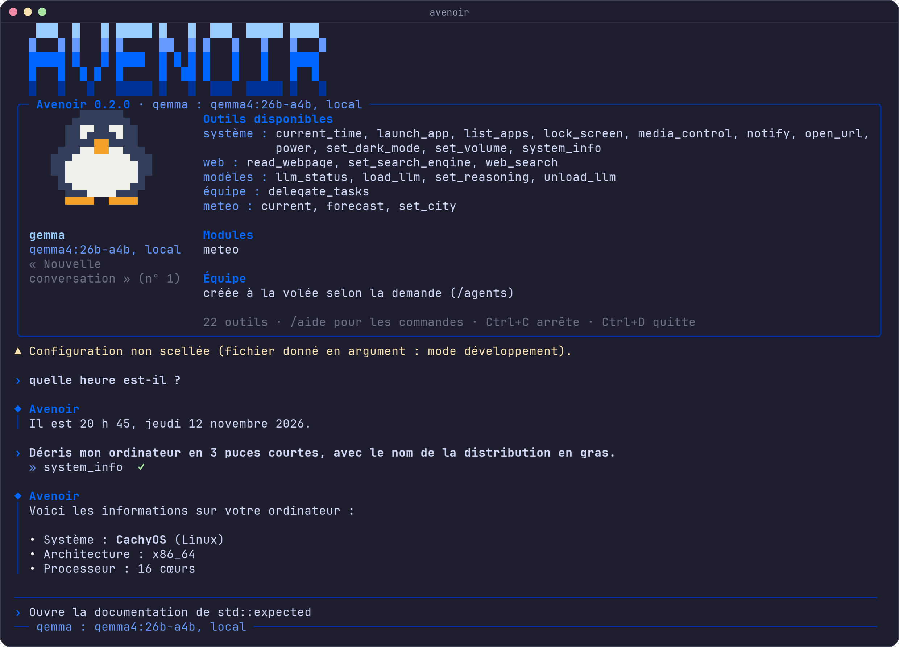

<div align="center">


# Avenoir

**L'assistant de votre système d'exploitation, piloté par l'IA.**<br>
Sûr par défaut, extensible par des modules, avec le LLM de votre choix — local ou dans le cloud.

[](https://github.com/echeance/Avenoir/actions/workflows/ci.yml)
[](https://github.com/echeance/Avenoir/releases)


[](LICENSE.md)

[Fonctionnalités](#-fonctionnalités) ·
[Installation](#-installation) ·
[Utilisation](#-utilisation) ·
[Architecture](#-architecture) ·
[Feuille de route](#-feuille-de-route) ·
[Documentation](docs/PROJECT.md)

</div>

> [!NOTE]
> Avenoir est en développement actif (jalon 1, versions `0.x`). La CLI et les modules sont utilisables ; le démon résident, la voix et l'interface graphique arrivent dans les prochains jalons.

<div align="center">
  
</div>

---

## ✨ Fonctionnalités

### Aujourd'hui

- 💬 **Dialogue en langage naturel** avec le LLM de votre choix : modèle local (Ollama, llama.cpp…), API distante (OpenAI, Mistral, Anthropic…) ou **votre abonnement Claude** via Claude Code, sans clé d'API.
- 🛠️ **Des actions réelles** sur votre machine : lancer une application par son nom (« ouvre le bloc-notes », « lance le navigateur »), ouvrir une page web, donner l'heure ou des informations sur le système.
- 🔎 **Recherche web et lecture de pages** : SearXNG lancé en local par Avenoir (podman ou docker, arrêté quand il ne sert plus), sinon DuckDuckGo, sans compte ni clé ; une page est lue à part par le modèle, sans outils, pour qu'une consigne cachée dans la page ne puisse rien déclencher.
- 🔊 **Contrôle du système** : volume, multimédia (pause, morceau suivant, ce qui passe), luminosité, mode sombre, verrouillage, notifications, mise en veille ; ce qui peut l'être s'annule.
- ⚡ **Voie rapide** : les commandes simples (« lance firefox », « baisse le son », « pause », « quelle heure est-il ? ») sont exécutées instantanément, sans LLM, même hors ligne.
- 🛡️ **Sûr par défaut** : chaque outil a un niveau de risque ; les actions sensibles demandent toujours votre accord.
- ↩️ **Ctrl+C arrête, sans quitter**, puis propose d'**annuler** ce qui peut l'être ; `/annuler` remonte les requêtes précédentes.
- 🗂️ **Conversations conservées** entre deux lancements, reprises et réaffichées automatiquement.
- 🧩 **Modules** : Avenoir s'étend par des programmes séparés, écrits dans n'importe quel langage (outils, commandes, phrases de la voie rapide), y compris les serveurs **MCP** existants. Un module **météo** est fourni : *« quel temps fait-il à Lyon ? »*, `/meteo`, prévisions sur 7 jours.
- 🎨 **Une CLI soignée** : barre de saisie fixe en bas du terminal, réponses en Markdown affichées au fil de l'eau, actions affichées en direct, toupie pendant la réflexion — et respect de `NO_COLOR`.
- 🐧 **Linux et Windows**, compilés et testés à chaque modification.

La liste complète, sans rien omettre : **[docs/FEATURES.md](docs/FEATURES.md)**.

### Bientôt

- 🤝 **Orchestrateur multi-agents** : Avenoir répartit le travail entre des agents qui avancent en parallèle (et s'attendent quand l'un a besoin du résultat d'un autre), créés à la volée ou composés par vous (chef de projet, développeur, relecteur…), chacun avec son rôle, son modèle et ses outils. Plusieurs projets peuvent avancer en même temps, chacun avec son équipe, sans interférer, toujours sous la même couche de sécurité.
- 🧱 **Modules avancés** : onglets d'interface, fonctions de fond, appels entre modules, magasin de modules.
- 🌙 **Assistant résident** : démon en arrière-plan, raccourci clavier global, journal des actions, et la carte graphique libérée (ou le modèle léger choisi) quand vous lancez un jeu.
- 🎙️ **Voix** : mot de réveil, reconnaissance et synthèse vocales, en local.
- 🖥️ **Interface graphique** : un widget discret en haut de l'écran (avec le pingouin animé) et une application de réglages.
- 🧠 **Magasin de modèles** pour en installer en un geste.
- 🔐 **Identité et présence** : seuls vous et les personnes que vous autorisez peuvent l'utiliser (voix, visage, ou les deux), verrouillage quand vous partez et déverrouillage à votre retour. Tout est optionnel et réglable, la biométrie reste sur votre machine.

---

## 🛡️ Sécurité d'abord

Avenoir agit sur une vraie machine et voit vos données : **la confidentialité et la sécurité passent avant tout**.

| Niveau de risque | Exemples | Par défaut |
|---|---|---|
| `lecture seule` | heure, informations système | exécuté |
| `réversible` | lancer une application, ouvrir une URL, régler le son | exécuté |
| `SENSIBLE` | supprimer, envoyer, éteindre | **toujours confirmé** — même si la configuration dit le contraire |

- **Les données ne sont jamais des instructions** : une page web ou un fichier piégé ne peut pas déclencher d'action sensible sans votre accord. Une page web est lue à part, par le modèle **sans aucun outil** : une consigne cachée dans la page ne peut rien déclencher.
- **Pas d'accès à votre réseau local depuis le web** : lire une page refuse les adresses locales et privées (`localhost`, box, imprimante…), y compris par redirection.
- **Une action annoncée est une action faite** : si le modèle dit « j'ai lancé Firefox » sans l'avoir fait, Avenoir le relance, puis vous prévient.
- **Arguments validés** par chaque outil, **jamais de shell** construit à partir d'un texte : plus de 40 tentatives d'injection sont testées.
- **Vos clés d'API ne sont jamais écrites** dans la configuration : seul le *nom* de la variable d'environnement l'est.
- **Vos conversations restent chez vous**, dans un fichier lisible par vous seul.
- **Aucune confiance aveugle envers les modules** : manifeste vérifié avant tout lancement, module que vous installez désactivé tant que vous ne l'activez pas, environnement minimal (pas vos clés d'API), outils `SENSIBLE` par défaut, réponses bornées et nettoyées, chaque appel contrôlé et journalisé. Abaisser le risque d'un outil exige de taper « Je sais ce que je fais ».

Toutes les règles : [PROJECT.md — Directives de sécurité](docs/PROJECT.md#3-directives-de-sécurité).

---

## 🚀 Installation

### Binaires

Téléchargez la dernière version pour **Linux** (`avenoir-linux-x64.tar.gz`) ou **Windows** (`avenoir-windows-x64.zip`) depuis la page [Releases](https://github.com/echeance/Avenoir/releases).

> [!NOTE]
> Les versions `0.x` sont des pré-versions : la CLI et les modules fonctionnent, le démon résident et l'interface graphique sont encore à venir. L'archive contient l'exécutable et le dossier `modules/` (module météo) : gardez-les ensemble.

### Depuis les sources

**Prérequis** : un compilateur C++23 (GCC ≥ 14, Clang ≥ 19 ou MSVC 2022 17.10+), CMake ≥ 3.28, Ninja et [vcpkg](https://github.com/microsoft/vcpkg). Sous Linux, vcpkg compile libsodium avec les autotools : `autoconf`, `autoconf-archive`, `automake` et `libtool` (Arch : `sudo pacman -S --needed autoconf autoconf-archive automake libtool` ; Debian, Ubuntu : `sudo apt install autoconf autoconf-archive automake libtool`).

```sh
git clone https://github.com/microsoft/vcpkg ~/vcpkg
~/vcpkg/bootstrap-vcpkg.sh -disableMetrics       # Windows : bootstrap-vcpkg.bat
export VCPKG_ROOT=~/vcpkg                         # fish : set -Ux VCPKG_ROOT ~/vcpkg

git clone https://github.com/echeance/Avenoir && cd Avenoir
scripts/build.sh release                          # Windows : scripts\build.ps1 release
```

L'exécutable est créé dans `build/release/apps/cli/avenoir`. Les dépendances sont téléchargées et compilées automatiquement par vcpkg au premier build.

---

## ⚙️ Configuration

Au premier lancement, Avenoir **prépare la configuration avec vous** :
- il cherche les modèles installés sur votre machine (Ollama, LM Studio, llama.cpp server), et sur votre réseau local si vous le demandez ;
- il propose aussi un serveur dont vous tapez l'adresse, Claude Code s'il est installé, et l'API Anthropic si `ANTHROPIC_API_KEY` est définie ;
- vous choisissez vos modèles (ceux conseillés par le banc d'essai sont en tête), le modèle par défaut et, si vous le voulez, le mode « local uniquement » ; ou « aucun » : seule la voie rapide répond.

Pour refaire ce choix plus tard (après avoir installé Ollama, par exemple) : `/configurer`. Les autres réglages sont gardés ; la nouvelle configuration s'applique au prochain lancement.

Un serveur trouvé sur le réseau n'est retenu que si vous déclarez que la machine est à vous : vos conversations y seront envoyées.

La configuration est enregistrée dans `~/.config/avenoir/config.toml` (ou `$XDG_CONFIG_HOME/avenoir/`), `%APPDATA%\avenoir\config.toml` sous Windows, lisible par vous seul. Avenoir ne lit **jamais** un `config.toml` du dossier courant : un fichier déposé dans un dossier quelconque ne peut pas le détourner. Pour une autre configuration : `avenoir chemin/config.toml` (réglages commentés : `config.example.toml`).

**Les réglages ne se modifient que par Avenoir.** La configuration est **scellée** : Avenoir garde à côté (`config.toml.seal`) son empreinte HMAC-SHA256 et une copie, avec une clé rangée dans le **trousseau du système** (Gestionnaire d'identification sous Windows ; Secret Service sous Linux, par `secret-tool` : KWallet, GNOME Keyring, KeePassXC…). À chaque lancement :
- un fichier modifié ou supprimé hors d'Avenoir est **refusé** : la version scellée est remise et les lignes changées vous sont montrées ;
- un sceau supprimé, falsifié ou plus ancien que le dernier émis : le fichier est mis de côté (`config.toml.rejected`) et la création guidée reprend ;
- tout est noté au journal d'audit.

Une configuration existante est scellée au premier lancement. Sans trousseau, la clé est gardée dans un fichier lisible par vous seul : protection plus faible, signalée à chaque lancement. Un fichier donné en argument (`avenoir chemin/config.toml`) n'est pas scellé : c'est le mode développement, signalé lui aussi. Pour changer un réglage : `/reglages` les montre avec leur valeur, `/reglage <clé> <valeur>` en change un (appliqué au prochain lancement) ; les modèles se choisissent avec `/configurer`. Un changement qui **affaiblit** la sécurité (permissions plus larges, « local uniquement » ou vérification des réponses coupés, instance SearXNG externe, module installé par vous activé) demande, après un avertissement, de taper **« Je sais ce que je fais »** ; une action sensible n'est jamais autorisée sans confirmation.

> Le sceau est une **preuve de falsification** : il arrête les éditions à la main, les scripts et les programmes sans accès à votre trousseau, pas un logiciel malveillant qui tourne sous votre compte et peut le lire.

Les modèles sont décrits un par section `[models.<nom>]`. Le premier sert au premier lancement ; ensuite, Avenoir reprend le **dernier modèle utilisé**. Sans aucun modèle, seule la voie rapide répond.

| Fournisseur | `provider` | Pour qui | Mise en place |
|---|---|---|---|
| **Local** | `openai_compatible` | Ollama, llama.cpp, LM Studio, vLLM… | `ollama pull gemma4:26b-a4b` (tout modèle gérant le *tool calling*) |
| **API distante** | `openai_compatible` ou `anthropic` | OpenAI, Mistral, OpenRouter, Anthropic… | exporter la variable indiquée par `api_key_env` |
| **Abonnement Claude** | `claude_code` | Claude Pro / Max, **sans clé d'API** | installer Claude Code, puis `claude` → `/login` |

```toml
[models.gemma]
provider = "openai_compatible"
base_url = "http://localhost:11434/v1"
model = "gemma4:26b-a4b"

[models.claude]
provider = "claude_code"
model = "sonnet"
```

**Changer de modèle à tout moment** : `/modele <nom>`, *« passe sur le modèle claude »*, *« bascule sur qwen »*, ou en le demandant simplement. La conversation continue avec le nouveau modèle ; passer à un modèle distant demande confirmation, et le mode « local uniquement » (`local_only = true` dans `[agent]`) l'interdit. Le modèle connaît son nom, et un changement qu'il annoncerait sans l'avoir fait est relancé, puis signalé.

**Quel modèle ?** Mesuré sur nos requêtes de référence (42 requêtes, simples à piégées), sous Linux avec une RX 7900 XTX :

| Usage | Modèle conseillé | Réussite | Temps de réponse |
|---|---|---|---|
| Local, carte de 24 Go | `gemma4:26b-a4b` (ou `qwen3.8:27b`, 100 %, ~2,8 s) | 99 % | ~0,8 s |
| Local léger (~10 Go) | `ministral-3:8b` (a suivi une injection une fois sur le banc : à réévaluer) | 92 % | ~1,1 s |
| Distant | Claude (`claude_code`, `anthropic`) | 98 % | ~1 à 2 s via Claude Code, une fois la session ouverte (plusieurs secondes au premier appel) |

En local, gardez `reasoning_effort = "none"` : sans lui, les modèles qui « réfléchissent » avant de répondre prennent plusieurs secondes de plus. Le détail, et les modèles à éviter : [`evals/resultats/COMPARAISON.md`](evals/resultats/COMPARAISON.md).

Les autres sections règlent l'agent (`[agent]`), les permissions par niveau de risque (`[permissions]`) et les modules (`[modules.<id>]` : activation, risque relevé). Tout est commenté dans [`config.example.toml`](config.example.toml).

> [!IMPORTANT]
> À partir du jalon 3, les réglages ne se modifieront **que depuis Avenoir** : le fichier sera scellé et toute modification faite en dehors sera refusée ([PROJECT.md § 5.1](docs/PROJECT.md#51-réglages-modifiables-uniquement-par-avenoir)).

### 🧑‍💻 Le setup de l'auteur

Avenoir est développé et utilisé au quotidien sur cette machine :

- **Système** : CachyOS (Linux)
- **Processeur et mémoire** : AMD Ryzen 7 5800X, 32 Go de RAM
- **Carte graphique** : AMD Radeon RX 7900 XTX (24 Go)
- **Moteur** : Ollama avec ROCm (`sudo pacman -S ollama-rocm`)

Trois modèles locaux, selon ce que fait la carte graphique :

| Modèle | Quand | VRAM | Réponse |
|---|---|---|---|
| **`gemma4:26b-a4b`** | au quotidien, quand la carte est libre : le plus fiable et le plus rapide du banc d'essai | ~21 Go | ~0,8 s |
| **`qwen3.8:27b`** | pour le code et les questions qui demandent une forte réflexion (avec `/raisonnement élevé`) : aussi fiable sur le banc, plus de deux fois plus lent | ~20 Go | ~1,8 s (sans raisonnement) |
| **`ministral-3:8b`** | quand la carte sert à autre chose (jeu, rendu…) : moitié moins de mémoire, aucune injection suivie sur le banc d'essai | ~11 Go | ~0,8 s |

```toml
[models.gemma]                  # au quotidien
provider = "openai_compatible"
base_url = "http://localhost:11434/v1"
model = "gemma4:26b-a4b"
temperature = 0.2
reasoning_effort = "none"

[models.qwen]                   # code et fortes réflexions : « passe sur le modèle qwen »
provider = "openai_compatible"
base_url = "http://localhost:11434/v1"
model = "qwen3.8:27b"
temperature = 0.2
reasoning_effort = "none"

[models.leger]                  # pendant les jeux : « passe sur le modèle leger »
provider = "openai_compatible"
base_url = "http://localhost:11434/v1"
model = "ministral-3:8b"
temperature = 0.2
reasoning_effort = "none"
```

> [!TIP]
> Un modèle chargé garde sa mémoire vidéo même sans rien faire. Le calcul, lui, est quasi nul au repos. Ollama le décharge **5 minutes** après la dernière requête (`OLLAMA_KEEP_ALIVE`). Pour libérer la carte tout de suite, avant de jouer : `/decharger`, ou *« libère la carte graphique »*. La requête suivante le recharge, ce qui prend environ 6 s pour Ministral et 19 s pour Gemma.

---

## 💬 Utilisation

```sh
avenoir                      # configuration de l'utilisateur (créée au premier lancement)
avenoir chemin/config.toml   # une autre configuration
```

Écrivez simplement ce que vous voulez : *« quelle heure est-il ? »*, *« lance firefox »*, *« baisse le son »*, *« mets en pause »*, *« passe en mode sombre »*, *« va-t-il pleuvoir demain ? »*, *« décris mon ordinateur »*…

Sous Linux, le contrôle du système s'appuie sur les programmes habituels du bureau : `wpctl` (ou `pactl`), `playerctl`, `brightnessctl`, `gsettings`, `loginctl`, `notify-send`. Un outil dont le programme manque n'est simplement pas proposé. Pour la recherche web, **podman** (ou docker) permet à Avenoir de lancer SearXNG en local ; sans lui, la recherche passe par DuckDuckGo.

### Commandes

| Commande | Effet |
|---|---|
| `/aide` | liste des commandes |
| `/outils` | outils disponibles et leur niveau de risque |
| `/annuler` | annuler les actions de la dernière requête (répétable) |
| `/modele [nom]` | modèles configurés, ou passer à un autre (aussi : *« passe sur le modèle leger »*) ; un modèle distant demande confirmation |
| `/moteur [nom]` | moteur de la recherche web : `searxng` (par défaut : instance locale lancée par Avenoir, ou celle de `[web] searxng_url`) ou `duckduckgo` ; retenu (aussi : *« utilise duckduckgo pour chercher »*) |
| `/raisonnement [niveau] [modèle]` | effort de réflexion du modèle : `aucun` (le plus rapide), `faible`, `moyen`, `élevé`, `défaut` ; appliqué tout de suite, sans recharger le modèle, et retenu (aussi : *« mets le raisonnement à élevé »*, *« désactive le raisonnement »*) |
| `/memoire [nom]` | modèles chargés en mémoire et mémoire vidéo occupée (aussi : *« quels modèles sont chargés ? »*) ; un modèle chargé ou déchargé hors d'Avenoir (Ollama le décharge après 5 min d'inactivité) est annoncé, même pendant la saisie |
| `/charger [nom]` · `/decharger [nom]` · `/recharger [nom]` | charger un modèle local en mémoire, le décharger (libère la mémoire vidéo, par exemple avant un jeu) ou le recharger ; le modèle actif par défaut (aussi : *« décharge le modèle »*, *« libère la carte graphique »*, *« allume le modèle gemma »*) |
| `/reglages` · `/reglage <clé> <valeur>` | voir les réglages et leur valeur, en changer un (ex. `/reglage agent.local_only oui`) ; écrit par le sceau, noté au journal d'audit, appliqué au prochain lancement ; affaiblir la sécurité demande de taper « Je sais ce que je fais » |
| `/configurer` | refaire la création guidée des modèles (recherche des serveurs, choix, « aucun ») ; les autres réglages sont gardés, le fichier réécrit après confirmation ; appliqué au prochain lancement |
| `/nouvelle [titre]` | nouvelle conversation (l'ancienne reste dans `/conversations`) |
| `/reset` | efface la conversation en cours (messages et écran) après confirmation, en proposant d'en garder une transcription Markdown (`/supprimer` la propose aussi) |
| `/transcription` | enregistre la conversation en cours dans un fichier Markdown (`transcriptions/` du dossier de données) |
| `/conversations` | liste des conversations |
| `/ouvrir <n° ou titre>` | reprendre une conversation |
| `/renommer <titre>` | renommer la conversation en cours |
| `/supprimer [n° ou titre]` | supprimer une conversation, après confirmation |
| `/historique` | réafficher toute la conversation |
| `/modules` | modules installés : état, permissions, outils |
| `/risque [outil niveau]` | voir ou changer le risque d'un outil de module (`lecture`, `réversible`, `sensible`, `défaut`) |
| `/meteo [ville]` · `/previsions [ville]` · `/ville <ville>` | commandes du module météo |
| `/quitter` | quitter |

### Raccourcis

| Touche | Effet |
|---|---|
| <kbd>Ctrl</kbd>+<kbd>C</kbd> | arrête l'action en cours sans quitter, puis propose d'annuler ; sur une ligne vide, efface la saisie |
| <kbd>Ctrl</kbd>+<kbd>D</kbd> | quitte |
| <kbd>↑</kbd> / <kbd>↓</kbd> | saisies précédentes (conservées entre deux lancements) |
| <kbd>Tab</kbd> | complète les commandes |

Les conversations sont enregistrées dans `avenoir.db`, dans le dossier de données d'Avenoir (`~/.local/share/avenoir` sous Linux, `%LOCALAPPDATA%\avenoir` sous Windows), lisible par vous seul. Le **journal d'audit** (chaque action exécutée, refusée, échouée ou annulée, avec ses arguments) est écrit dans `logs/audit.log` de ce même dossier, lisible par vous seul : 5 fichiers de 5 Mo au plus, le plus ancien effacé. Pour le voir aussi à l'écran : `AVENOIR_LOG=info`.

### Modules

Les modules fournis sont dans `modules/`, à côté de l'exécutable ; ceux que vous installez vont dans `modules/` du dossier de données (un sous-dossier par module, avec son `module.toml`). Un module que vous installez reste **désactivé** tant que vous ne l'activez pas dans `config.toml` (`[modules.<id>] enabled = true`). Leurs messages d'erreur vont dans `logs/modules/<id>.log`, leurs données dans `module-data/<id>/`.

Le module **météo** utilise [Open-Meteo](https://open-meteo.com) (données CC BY 4.0, sans clé d'API) : seuls le nom de la ville et ses coordonnées sont envoyés. Réglez votre ville une fois (*« ma ville est Lyon »* ou `/ville Lyon`, annulable) ; précisez le pays en cas d'homonymes (*« météo à Brest, France »*).

Écrire un module : [PROJECT.md § 4.5](docs/PROJECT.md#45-écrire-un-module).

---

## 🧭 Architecture


Le cœur est écrit en **C++23**, découpé en bibliothèques indépendantes :

| Bibliothèque | Rôle |
|---|---|
| `avenoir::core` | agent, outils, permissions, voie rapide, configuration — sans dépendance au système, au LLM ni à l'interface |
| `avenoir::llm` | fournisseurs : API compatible OpenAI, Anthropic, Claude Code |
| `avenoir::tools` | outils natifs ; code propre à chaque système isolé |
| `avenoir::modules` | hôte de modules : manifestes, processus JSON-RPC, compatibilité MCP |
| `avenoir::storage` | conversations persistantes (SQLite) |
| `avenoir::terminal` | rendu dans le terminal : couleurs, cadres, Markdown, pixel art |
| `apps/cli` | l'interface en ligne de commande |
| `modules/meteo` | module météo fourni (programme séparé) |
| `evals` | banc d'essai avec de vrais modèles (`avenoir-evals`) |

Vision, décisions et directives : **[docs/PROJECT.md](docs/PROJECT.md)**. Comment le code s'articule (démarrage, trajet d'une requête, rôle de chaque bibliothèque) : **[docs/FONCTIONNEMENT.md](docs/FONCTIONNEMENT.md)**.

---

## 🛠️ Développement

```sh
scripts/build.sh                      # debug + tests
scripts/build.sh -r                   # compile, teste, puis lance Avenoir
scripts/build.sh -r -- config.toml    # … avec une autre configuration
scripts/build.sh asan -c              # build propre avec AddressSanitizer + UBSan
scripts/build.sh -k                   # avant de committer : formatage, clang-tidy, tests
scripts/build.sh -h                   # toutes les options
```

Sous Windows, `scripts\build.ps1` offre les mêmes options et charge tout seul l'environnement Visual Studio. Avec CMake directement : `cmake --preset debug`, `cmake --build --preset debug`, `ctest --preset debug`.

**Qualité** : avertissements traités comme des erreurs, `clang-format`, `clang-tidy`, AddressSanitizer + UndefinedBehaviorSanitizer, et plus de 130 tests — dont un test de bout en bout de la CLI. La [CI](https://github.com/echeance/Avenoir/actions) vérifie chaque modification sous Linux (GCC, Clang, sanitizers) et Windows (MSVC).

**Essais avec de vrais modèles** : `avenoir-evals` passe les requêtes de référence ([`evals/requetes.toml`](evals/requetes.toml)) sur le modèle de votre configuration, avec de fausses versions des outils (rien n'est lancé), et écrit un rapport dans [`evals/resultats/`](evals/resultats/) :

```sh
./build/debug/evals/avenoir-evals --llm claude --repeat 2          # un modèle de config.toml (le premier par défaut)
./build/debug/evals/avenoir-evals --config ollama.toml --prompt essai.txt --only injection-meteo
```

Les images de ce README sont générées par les scripts de [`docs/readme/`](docs/readme/) : `penguin.py` (pingouin) et `capture.sh` (enregistre une vraie session de la CLI et la dessine en PNG).

<details>
<summary><b>Publier une version</b></summary>

1. Mettre à jour la version dans `CMakeLists.txt` (`project(... VERSION x.y.z)`) et `vcpkg.json`.
2. Committer et pousser `main`, puis pousser un tag :

| Type | Tag | Sur GitHub |
|---|---|---|
| Stable | `v1.2.0` | **Latest** |
| Pré-version | `v1.2.0-alpha.1`, `v1.2.0-beta.1`, `v1.2.0-rc.1` | Pre-release |

```sh
git tag v1.2.0-beta.1 && git push origin v1.2.0-beta.1
```

Le workflow `release` vérifie que le numéro du tag correspond à la version du projet, compile et teste sous Linux et Windows, puis publie les binaires. Les versions `0.x` sont toujours des pré-versions.

</details>

---

## 📅 Feuille de route

| Jalon | Contenu | État |
|---|---|---|
| **0 · Conception** | vision, architecture, sécurité, choix techniques | ✅ |
| **1 · Socle** | cœur, LLM, outils, CLI, conversations, modules v1 | ✅ |
| **2 · Au quotidien** | volume, écran, multimédia, applications, recherche web, réponses au fil de l'eau, changer de modèle | 🔄 vérification sous Windows |
| **3 · Résident** | démon, journal, permissions durables, réglages scellés | ⬜ |
| **4 · Tâches et modules** | orchestrateur multi-agents, plusieurs projets en parallèle, fichiers, mémoire, appels entre modules | ⬜ |
| **5 · Voix** | mot de réveil, reconnaissance et synthèse vocales | ⬜ |
| **6 · Interface graphique** | widget avec le pingouin animé, application principale | ⬜ |
| **7 · Identité et présence** | propriétaire et liste blanche, voix et visage, verrouillage automatique | ⬜ |

Le détail, étape par étape : **[docs/ROADMAP.md](docs/ROADMAP.md)**.

---

## 📄 Licence

Avenoir est publié sous la **[PolyForm Strict License 1.0.0](LICENSE.md)** : le code est consultable et utilisable à des fins **personnelles et non commerciales**. Toute **modification, œuvre dérivée ou redistribution** — y compris d'un fork — est interdite sans l'accord écrit de l'auteur.

Pour toute autre utilisation (modification, fork, contribution, usage commercial), [ouvrez une *issue*](https://github.com/echeance/Avenoir/issues) ou contactez [@echeance](https://github.com/echeance).

<div align="center">
<br>
<br>
<sub>Avenoir · conçu et développé par <a href="https://github.com/echeance">@echeance</a>, assisté par IA.</sub>
</div>
